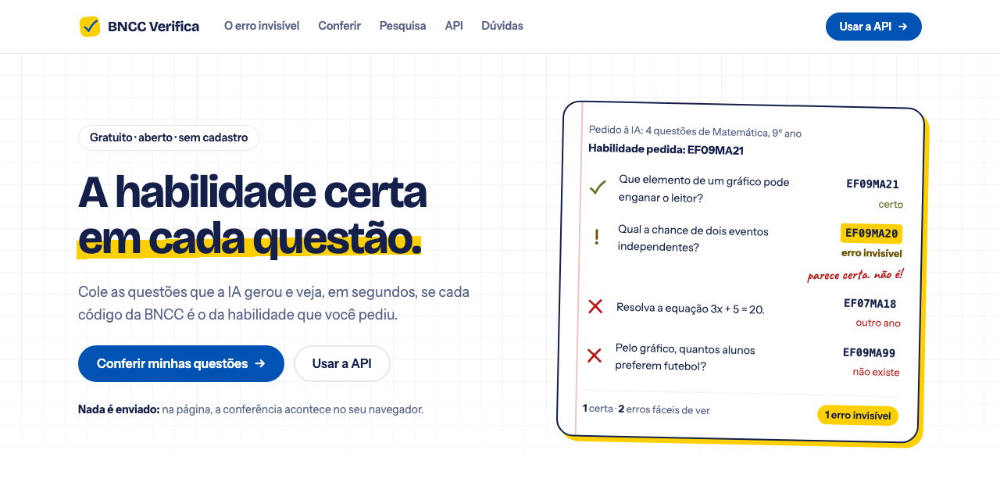
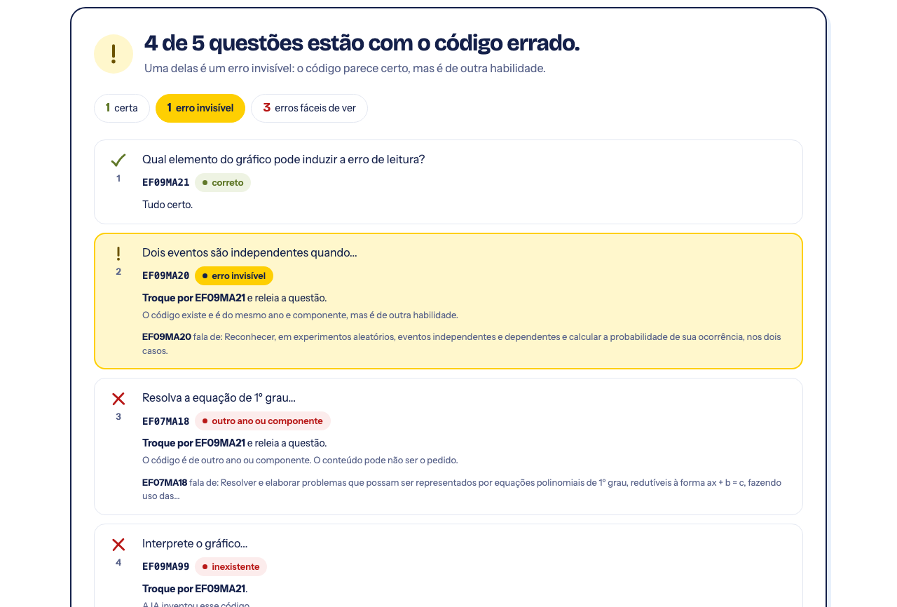
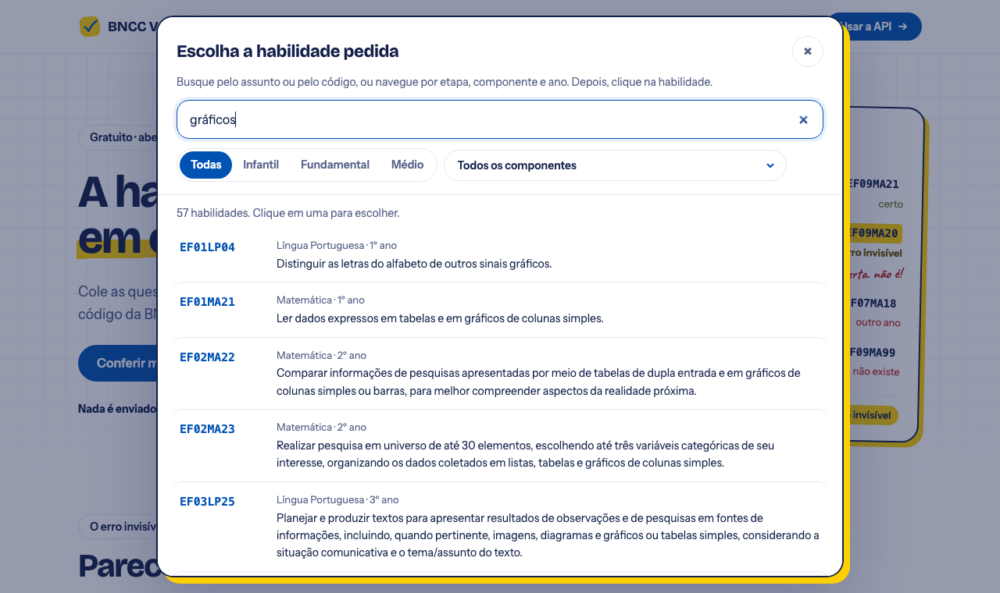
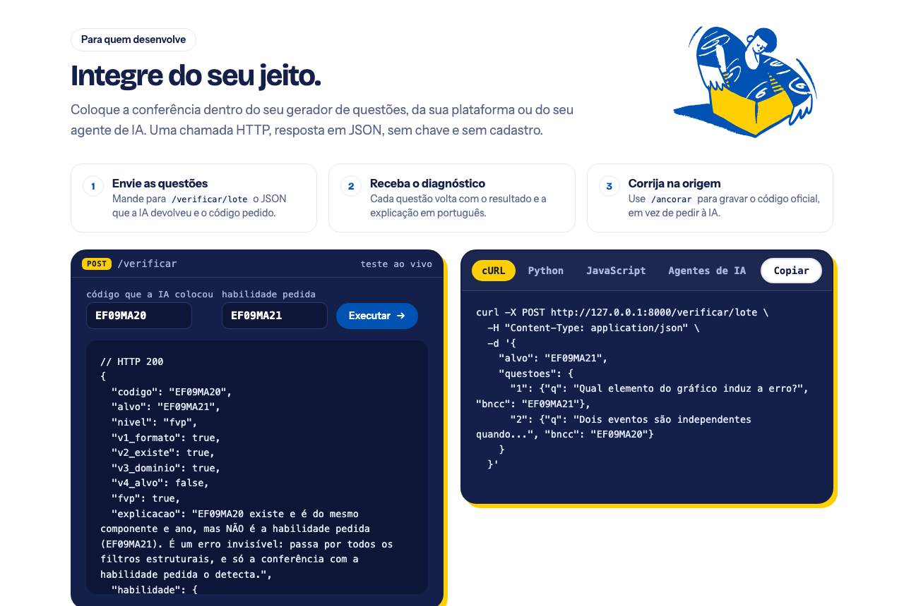
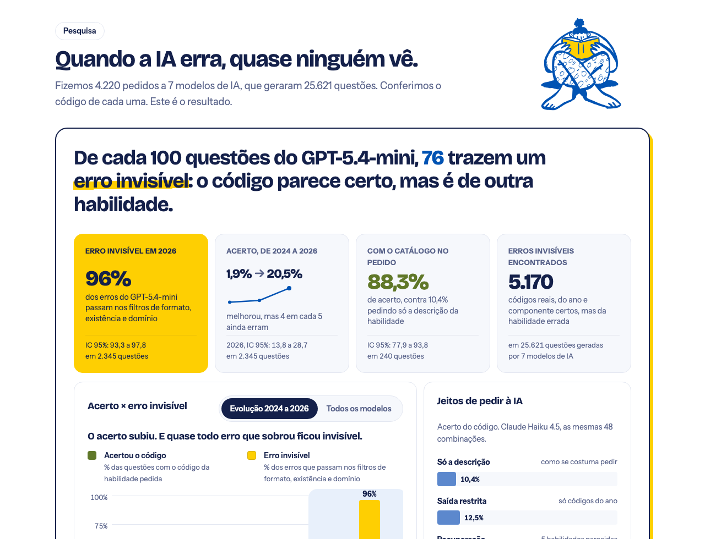

<div align="center">

# BNCC Verifica

**A habilidade certa em cada questão.**<br/>
Confere se o código da BNCC que a IA colocou na questão é o da habilidade que você pediu.

[](LICENSE)
[](pyproject.toml)
[](tests/)
[](https://github.com/bncc-lab/bncc-lab)

[Página](https://bncc-lab.github.io/api/) · [API](#2-api) · [Python](#3-python) · [Pesquisa](https://github.com/bncc-lab/bncc-lab)



</div>

## O problema

A IA quase não inventa mais código da BNCC. O erro que sobra é pior: **um código real, do ano e componente certos, mas de outra habilidade.** Nenhum filtro comum percebe. Chamamos isso de **erro invisível**.

| Pedido: `EF09MA21` | Código que a IA pôs | Filtro comum | BNCC Verifica |
|---|---|:---:|:---:|
| certo | `EF09MA21` | ✅ | ✅ certo |
| **erro invisível** | `EF09MA20` | ✅ passa | ⚠️ **pega** |
| outro ano | `EF07MA18` | ✅ passa | ❌ pega |
| não existe | `EF09MA99` | ❌ pega | ❌ pega |

> Na pesquisa, **96% dos erros do GPT-5.4-mini eram invisíveis**.

## Como usar

Grátis, aberto, sem cadastro. Nenhuma das formas chama modelos de IA.

### 1. Página

Escolha a habilidade, cole a resposta da IA e confira. Tudo roda no navegador.

| Resultado, questão a questão | Escolha da habilidade |
|---|---|
|  |  |

### 2. API

```bash
curl -X POST https://bncc-verifica.vercel.app/verificar \
     -H "Content-Type: application/json" \
     -d '{"codigo": "EF09MA20", "alvo": "EF09MA21"}'
# "nivel": "fvp"  (erro invisível)
```

| Rota | O que faz |
|---|---|
| `POST /verificar` | confere um código |
| `POST /verificar/lote` | confere todas as questões, do jeito que a IA devolveu |
| `POST /ancorar` | devolve o código oficial a partir do texto da habilidade |
| `GET /habilidade/{código}` | texto oficial, componente e ano |
| `GET /saude` | estado do serviço |

Funciona em qualquer site ou linguagem (CORS aberto). Documentação interativa em `/docs`.



### 3. Python

```python
import bncc_verifica as bv

bv.verificar("EF09MA20", alvo="EF09MA21")["nivel"]               # 'fvp'
bv.verificar_lote(questoes, alvo="EF09MA21")["resumo"]           # {'correto': 1, 'fvp': 1}
bv.ancorar("Identificar frações equivalentes")["habilidade"]     # código e texto oficiais
```

## Resultados possíveis

| Nível | Quer dizer |
|---|---|
| `correto` | é o código pedido |
| `fvp` | **erro invisível**: existe, é do ano e componente certos, mas é de outra habilidade |
| `fora_do_dominio` | existe, mas é de outro ano ou componente |
| `inexistente` | não existe na BNCC |
| `malformado` | não segue o padrão dos códigos |
| `aprovado_sem_alvo` | passa nos filtros, mas sem a habilidade pedida não dá para saber |

Cada código passa por 4 checagens: **formato → existência → ano e componente → habilidade pedida**. Só a última pega o erro invisível.

## A pesquisa



7 modelos de IA · 4.220 pedidos · 25.621 questões · 5.170 erros invisíveis. Dados, código e registros em [bncc-lab/bncc-lab](https://github.com/bncc-lab/bncc-lab).

## Para desenvolver

```bash
make instalar   # cria o ambiente
make testar     # 20 testes
make api        # http://127.0.0.1:8000/docs
make pagina     # http://127.0.0.1:8080
```

```
api/             API web (FastAPI)
bncc_verifica/   pacote Python: verificador e catálogo
data/            catálogo oficial (fonte única)
docs/            página (GitHub Pages) e capturas de tela
scripts/         extração dos códigos do PDF do MEC
tests/           testes
deploy/          configuração do Hugging Face
```

Mais: [publicar](DEPLOY.md) · [design system](DESIGN.md) · [contribuir](CONTRIBUTING.md)

## Dados da BNCC

- **1.580 códigos** da BNCC homologada em 2018: 1.304 do Fundamental, 183 do Médio e 93 da Infantil. A BNCC Computação (2022) ainda não entrou.
- Extraídos do PDF oficial do MEC. A URL e o SHA-256 do PDF ficam no próprio arquivo.
- `data/bncc_codigos.json` é a fonte. O `make dados` gera as cópias do pacote e da página.
- Iniciativa **independente**, sem vínculo com o MEC. Em caso de dúvida, vale o documento oficial.

## Limites

- Confere o **código**, não se a **questão** mede a habilidade. Isso ainda pede leitura pedagógica.
- Sem a habilidade pedida, só dá para saber se o código existe.
- Por pedido: código com até 40 caracteres, até 1.000 questões e texto de até 2.000 caracteres.

## Citar, licença e autores

- **Citar:** botão *Cite this repository* do GitHub ([CITATION.cff](CITATION.cff)).
- **Licença:** código em [MIT](LICENSE). Os textos da BNCC são do MEC.
- **Autores:** Joyce Beatriz Ferreira da Costa Silva e Jacson Rodrigues Barbosa (Instituto de Informática, UFG), Fabiane Fernandes da Silva e Danylo Bezerra Mendes (UFT).

<sub>*In English: BNCC Verifica checks whether the BNCC curriculum code an AI attached to a question is the code of the requested skill, catching the "invisible error" (a real code from the right subject and grade, but for another skill). Free page, web API and Python package.*</sub>
